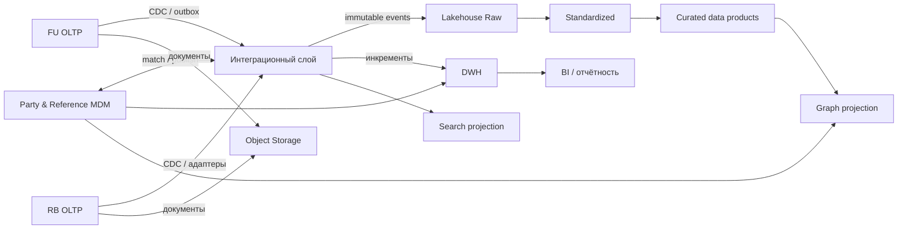

## Матрица размещения

| группа данных                                                  | основное хранилище                                 | дополнительные проекции                                                            | почему ?                                                                         |
| -------------------------------------------------------------- | -------------------------------------------------- | ---------------------------------------------------------------------------------- | -------------------------------------------------------------------------------- |
| Party, идентификаторы, связи, согласия                         | MDM; на переходе CRM + MDM crosswalk               | DWH, Lakehouse, API read model, ограниченная графовая проекция                     | Нужны match/merge, золотая запись, версионность и единый ID                      |
| Продукты, тарифы, статусы, сегменты, отделения, классификаторы | Reference MDM / Product Catalog                    | Кэш в OLTP, измерения DWH, публикация событий изменений                            | Общие коды и версии должны управляться централизованно                           |
| Договоры, счета, карты, кредиты                                | Профильные OLTP FU/RB, затем целевые доменные OLTP | DWH, Lakehouse, единый профиль                                                     | ACID, низкая задержка, сложные инварианты и непрерывность обслуживания           |
| Платежи и финансовые операции                                  | Payments/Core/Cards OLTP                           | Событийная шина, DWH, Lakehouse, поисковая проекция по безопасным полям            | Идемпотентность и строгая целостность в мастере; масштабируемая история вне OLTP |
| Проводки и текущие остатки                                     | Core Ledger OLTP                                   | Снимки и факты DWH; история Lakehouse                                              | Официальный учёт должен быть авторитетным и сверяемым                            |
| Обращения                                                      | CRM/Case Management OLTP                           | Поисковый индекс; DWH/Lakehouse для аналитики                                      | Полнотекстовый поиск отделён от транзакционной записи                            |
| Документы, аудио, batch-файлы, архивные выгрузки               | Объектное хранилище                                | Метаданные в CRM/ECM/каталоге; поисковый индекс только для разрешённых производных | Дешёвое масштабирование, версии, WORM и lifecycle policy                         |
| Сертифицированная отчётность и BI                              | DWH                                                | BI semantic layer                                                                  | Стабильная модель, историчность, воспроизводимость и контролируемые метрики      |
| Детальные события, сырые и неструктурированные данные          | Data Lakehouse                                     | Curated data products, ML/исследовательские среды                                  | Большой объём, schema evolution, replay и открытые форматы                       |
| Связи клиентов, бенефициаров и контрагентов                    | Графовая БД как производная проекция               | Источник связей — MDM/KYC/CRM                                                      | Быстрый поиск путей и сообществ без назначения графа мастером                    |

## 1. OLTP БД

`Назначение`: договоры, счета, карты, кредиты, платежи, транзакции, проводки и текущие остатки.

**Требования:**

- ACID-транзакции, ограничения целостности и конкурентный доступ;
- высокая доступность, point-in-time recovery и проверяемые резервные копии;
- идемпотентность команд и transactional outbox для публикации событий;
- неизменяемость проведённых финансовых записей: исправление сторно/корректировкой;
- отдельные read replica/CDC, чтобы BI и миграция не читали основные таблицы тяжёлыми запросами.

В переходный период FU и RB OLTP остаются мастерами для открытых в них договоров. Маршрутизация использует `source_system`/`servicing_system`. Сводная платформа не выполняет распределённую транзакцию между двумя АБС: межсистемный процесс строится как saga с состояниями, идемпотентностью и компенсацией.

## 2. MDM

`Назначение`: золотая Party, исходные идентификаторы, связи сторон, продукты и общие справочники

`Функции`:
- deterministic и probabilistic match с объяснимыми правилами
- survivorship по атрибуту, а не `один источник лучше для всего`
- workflow Data Steward для неоднозначных совпадений
- merge/split с полной историей и возможностью исправить ошибку
- crosswalk глобальных и локальных ID

## 3. DWH

`Назначение`: регламентированная, финансовая и управленческая отчётность, сертифицированные BI-витрины

`Подход`:
- интеграционный слой с каноническими ключами и сохранением ключей FU/RB
- исторические измерения Party, Product, Agreement и Reference Data
- факты проводок, операций, платежей, остатков и обращений на явно заданной гранулярности
- semantic layer с владельцами показателей, версиями формул и датами вступления
- снимки закрытых периодов и воспроизводимость отчёта по `business_date`, версии правил и загрузки
- сверка source-to-target по количеству, суммам, валютам и контрольным hash

## 4. Data Lakehouse

`Назначение`: сырые CDC/события, полная история операций, логи взаимодействий, clickstream, аудио/текстовые производные, данные для antifraud/ML и ad hoc-аналитики

`Зоны`:
1. **Raw/immutable:** точная копия входа, метаданные источника, контрольная сумма и время приёма; ограниченный доступ
2. **Standardized:** канонические типы, техническая дедупликация, нормализованные временные зоны и коды
3. **Curated:** доменные таблицы/data products с DQ-контрактами и владельцами

Табличный формат должен поддерживать ACID, schema evolution, time travel и открытое чтение несколькими движками. Компакция малых файлов, партиционирование и lifecycle обязательны. Lakehouse не подменяет Core Ledger или сертифицированный DWH

## 5. Объектное хранилище

`Назначение`: сканы и подписанные документы, записи звонков, исходные batch-файлы, архивы, отчётные формы и резервные экспортные наборы

`Требования`:
- приватные контейнеры, шифрование собственными управляемыми ключами и короткоживущие signed URL
- versioning, object lock/WORM и legal hold для юридически значимых материалов
- hash содержимого, антивирусная проверка, запрет исполняемого контента по умолчанию
- lifecycle между hot/cold/archive tier и контролируемое удаление
- метаданные и права в ECM/каталоге; URI объекта не должен давать доступ сам по себе

Batch-файл считается транспортным артефактом. Его наличие не доказывает успешную загрузку: сохраняются manifest, count/sum/hash и результат обработк

## 6. Графовая БД

`Обоснованный сценарий`: поиск цепочек владения и аффилированности, общих телефонов/адресов/устройств, поручителей, получателей платежей и потенциальных `fraud rings`

`Модель`: вершины Party, Account, Device, Address и Organization; рёбра `OWNS`, `BENEFICIARY_OF`, `REPRESENTS`, `GUARANTEES`, `USES_DEVICE`, `TRANSFERS_TO` с источником, уверенностью и периодом действия

## 7. Поисковый движок

`Обоснованный сценарий`: полнотекстовый поиск по обращениям и разрешённым метаданным документов, быстрый поиск клиента по нескольким нормализованным ключам, работа контакт-центра

`Ограничения`:
- индекс является производной read model и полностью восстанавливается из мастеров
- индексировать только необходимые поля; PAN, CVV/CVC, секреты и полные реквизиты документов исключаются
- document-level security/filtered aliases не заменяют авторизацию приложения
- запрос пользователя проверяется в мастер-сервисе до показа чувствительных деталей
- короткий retention для query logs, маскирование запросов и аудит массового поиска
- обновления доставляются через CDC/события, а рассинхронизация контролируется по SLA

## Потоки и разделение нагрузки

- CDC предпочтительнее ночных полных выгрузок; где CDC недоступен, используется инкремент по надёжному watermark с периодической полной сверкой
- События содержат идентификатор, версию схемы, business/occurred time, produced time, source и correlation ID
- Потребители обязаны быть идемпотентными; exactly-once на всём пути не предполагается.
- Схемы и совместимость контрактов управляются централизованно; PII не публикуется `на всякий случай`

## Реализация по этапам

### 0–3 месяца

1. Развернуть crosswalk/минимальный Party MDM и очередь ручной проверки
2. Снять инкрементальные копии FU/RB в изолированную landing/raw-зону; не запускать BI-запросы на production OLTP
3. Согласовать mapping продуктов, статусов, валют, сегментов и отделений
4. Построить интеграционный слой DWH и четыре сертифицированные витрины: клиенты, счета/остатки, продукты/договоры, операции
5. Ввести source-to-target сверки, каталог критичных наборов и минимальный технический lineage
6. Оставить граф и полнотекстовый поиск как ограниченные пилоты, если они не нужны для первого совместного обслуживания

### 4–12 месяцев

1. Промышленный MDM, Reference MDM/Product Catalog и доменные контракты событий
2. Lakehouse с raw/standardized/curated, каталогом и политиками доступа
3. Целевой DWH и semantic layer для управленческой и регуляторной отчётности
4. Поисковая и графовая проекции для подтверждённых сценариев
5. Волновая миграция продуктов с trial migration, сверкой, периодом параллельной работы и rollback plan
6. Переключение потребителей и отключение legacy только после подтверждения полноты, финансовой сверки и завершения обязательного срока хранения

## Антипаттерны

- единая общая БД, в которую FU и RB пишут напрямую
- использование DWH/Lakehouse как мастера текущего остатка
- двунаправленная синхронизация без владельца атрибута и правил конфликтов
- автоматическое объединение Party только по ФИО или телефону
- ночные полные выгрузки как постоянный интеграционный механизм
- хранение документов и ПДн в общих файловых папках
- отчёты с прямыми запросами к production OLTP
- поисковый индекс или граф как единственное место хранения данных
