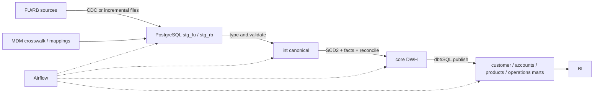

| ID     | пайплайн                       | источники                                   | приёмники                                             | тип                                | основные инструменты                                           | потребители                   |
| ------ | ------------------------------ | ------------------------------------------- | ----------------------------------------------------- | ---------------------------------- | -------------------------------------------------------------- | ----------------------------- |
| **P0** | Промежуточный PostgreSQL DWH   | FU/RB CRM, Core, Cards, Loans, MDM mapping  | PostgreSQL DWH marts                                  | Incremental batch / ETL-ELT        | Airflow, managed file/CDC adapters, SQL/dbt, PostgreSQL        | BI, Finance                   |
| **P1** | Golden Party                   | CRM/KYC/каналы                              | Party MDM, Kafka, DWH, Lakehouse                      | CDC + event-driven + MDM           | CDC/outbox, Kafka, MDM match engine, Schema Registry           | CRM, Customer 360, BI, Risk   |
| **P2** | Финансовые операции и проводки | Core/Payments/Core Ledger                   | Iceberg Raw/Standardized, DWH                         | CDC/streaming + EOD batch          | Kafka, stream processor, Airflow, Spark/dbt, DQ/reconciliation | Finance, BI, Regulatory       |
| **P3** | Карточная история и события    | Card Processing, clearing files             | Iceberg Raw/Standardized/Curated, агрегаты DWH        | Streaming + batch reconciliation   | Kafka, Flink/Kafka Streams, Iceberg, Airflow, Trino            | Antifraud, Risk, BI           |
| **P4** | Кредитный портфель             | Loan Platform, Core Ledger, Risk engine     | Lakehouse, DWH risk/finance marts                     | CDC + daily snapshot / ELT         | Kafka/CDC, Airflow, Spark/dbt, Iceberg, DWH                    | Risk, Finance, Regulatory     |
| **P5** | Обращения и клиентские каналы  | CRM/Case, contact center, web/mobile events | Object Storage, Iceberg, DWH service mart             | Streaming + batch, semi-structured | Kafka, object storage, Iceberg, NLP jobs, Trino                | Customer Service, BI, Quality |
| **P6** | Архивная миграция RB           | DB snapshots, CSV/XML, файловые архивы      | Object Raw, Iceberg Standardized, целевые DWH subsets | Controlled bulk batch              | Airflow, Spark, Iceberg, checksum/manifest tools               | Migration, Audit, Finance     |

## P0. Простой DWH на PostgreSQL - состояние через три месяца

### Назначение

Выпустить минимальные согласованные витрины клиентов, продуктов/договоров, счетов/остатков и операций до готовности промышленного Lakehouse.

### Поток

### Шаги

1. Airflow получает watermark предыдущей успешной загрузки
2. Адаптер извлекает изменения через CDC/read replica; для legacy - инкрементальный файл с overlap window и manifest
3. Данные bulk-load в отдельную staging-таблицу с `batch_id`, source key, extract time и hash
4. SQL/dbt выполняет типизацию, нормализацию времени/валют, техническую дедупликацию и mapping локальных кодов
5. MDM crosswalk назначает `global_party_id`; неразрешённые Party сохраняются как `unresolved`, а не отбрасываются
6. Загружаются SCD2 dimensions и факты; повторный запуск идемпотентен по source key/version
7. Выполняются count/sum/hash, debit-credit и balance roll-forward
8. Витрины публикуются транзакционно только при пройденных quality gates
9. Airflow публикует run status, DQ и lineage в DataHub

### SLA и отказ

- инкрементальные витрины - до 30–60 минут в зависимости от источника
- сертифицированный EOD - к согласованному утреннему deadline
- ошибка одной сущности не помечает весь batch успешным
- исходный файл/CDC offset сохраняется, запись попадает в quarantine
- закрытый период не перезаписывается: публикуется adjustment/version

Это временная архитектура: raw-history выгружается в object storage, чтобы PostgreSQL staging не стал бессрочным архивом

## P1. Golden Party

### Поток

`CRM/KYC commit -> outbox/CDC -> Kafka party-candidate -> normalize/tokenize -> MDM match -> steward queue или golden Party -> Kafka golden-party -> CRM/DWH/Iceberg`

### Обработка

- deterministic match по проверенным сильным идентификаторам
- probabilistic match по комбинации атрибутов с объяснимым score
- запрет auto-merge по одному телефону/e-mail/ФИО
- survivorship по атрибуту и доверенности источника
- merge/split как отдельное versioned событие
- DWH хранит SCD2 Party и bridge source/global IDs
- Raw Lakehouse сохраняет вход/решение с ограниченным доступом для аудита и улучшения правил

### Контроли

- один действующий `(source_system, source_party_id)` относится не более чем к одному global Party
- confidence, rule version и steward decision обязательны
- все consumers подтверждают применение merge/split
- доступ к match features ограничен и аудируется

## P2. Финансовые операции, проводки и остатки

### Поток

`Core/Payments -> CDC/outbox -> Kafka -> Raw Iceberg -> Standardized -> DWH facts`  
`Core Ledger EOD manifest/snapshot -> object storage -> Airflow reconciliation -> DWH certification`

### Правила

- event time, posting time и business date хранятся отдельно
- Payment Order, Financial Transaction и Accounting Entry не сливаются в одну сущность
- streaming создаёт предварительный operational view
- EOD snapshot подтверждает полноту событий
- пакет проводок должен быть сбалансирован
- остаток объясняется начальным остатком и движением
- late event после закрытия создаёт controlled adjustment

### Технологии

Kafka доставляет события, stream processor нормализует envelope и dedup, Iceberg сохраняет replayable историю, Airflow запускает EOD, dbt/SQL строит DWH, DataHub принимает lineage

## P3. Карточная история и события

### Поток

`Card authorization/clearing/reversal -> Kafka -> stream processing -> Iceberg`  
`Scheme clearing file -> object storage -> Airflow -> reconciliation`

Stream job:

- токенизирует/проверяет отсутствие полного PAN и CVV
- нормализует currency, MCC, merchant, status и timestamps
- связывает authorization -> clearing -> reversal
- удаляет технические дубли по source event ID
- вычисляет разрешённые оконные признаки для antifraud
- пишет Raw/Standardized/Curated отдельными атомарными snapshots

В DWH передаются согласованный факт карточной операции и необходимые дневные агрегаты, а не все технические версии авторизации.

## P4. Кредитный портфель

### Поток

`Loan lifecycle CDC + EOD loan snapshot + Core Ledger balance + Risk grade -> Standardized Iceberg -> reconcile -> DWH loan facts/marts`

### Контроли

- график платежей соответствует сумме, ставке и сроку договора
- заёмщик/созаемщик/поручитель связаны через global Party ID и роль
- principal, interest и overdue сверяются с ledger
- risk grade имеет источник, model/rule version и effective date
- изменение после закрытия периода оформляется новой версией

Lakehouse хранит детальные графики, model features и snapshots; DWH - сертифицированную задолженность, просрочку, резервы и отчётные срезы

## P5. Обращения и события каналов

### Поток

- CRM cases поступают через CDC/events
- web/mobile clickstream поступает в Kafka
- аудио и документы сохраняются в object storage, Iceberg содержит метаданные
- NLP/transcription запускается отдельным контролируемым job
- в DWH публикуются структурированные обращения, SLA и безопасные агрегаты

Свободный текст проходит DLP/redaction. Полный текст/аудио не копируется в обычную BI-витрину; доступ выдаётся по purpose и retention

## P6. Архивная миграция RetailBank

### Шаги

1. Зарегистрировать manifest архива: источник, период, схема, encoding, количество, суммы, hash и владелец
2. Сохранить оригинал immutable в Landing/Raw
3. Проверить malware, checksum, читаемость и соответствие manifest
4. Spark-job распознаёт схему, приводит типы и помещает отклонения в quarantine
5. Применить source/global ID и reference mappings с версией
6. Записать Standardized Iceberg snapshot и выполнить source-to-target reconciliation
7. Только нужный сертифицированный subset загрузить в DWH
8. Зафиксировать lineage, sign-off и retention оригинала

Bulk pipeline не записывает напрямую в target OLTP. Операционная миграция выполняется отдельным процессом с trial run, cutover и rollback
